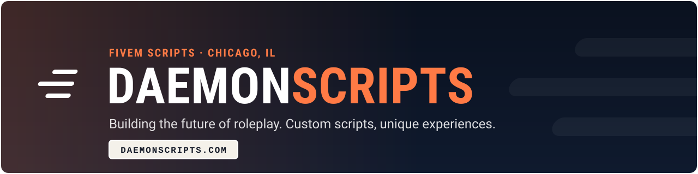

<!-- Header: the DelPerroSands kit B look (navy, white edge, brand orange #ff7a45) -->

<!-- Typing line in the brand orange -->

<!-- The one action in orange; the rest calm navy -->

  

<table>
<tr>
<td align="center" width="50%">

**FIVEM SCRIPT DEVELOPMENT**

We build premium, optimized scripts for FiveM servers. From gameplay mechanics to immersive roleplay features: if you can imagine it, we can build it.

</td>
<td align="center" width="50%">

**OPEN SOURCE DPS SCRIPTS**

Our `dps-` collection is free and open source, built for the community, by the community. Quality scripts that just work.

</td>
</tr>
</table>

 

 

  

 

<!-- The old activity-graph service now answers 402 (payment required); streak stats takes kit colours. -->

  

 

 

| Script | Description |
|--------|-------------|
| [dps-gangwars](https://github.com/DaemonAlex/dps-gangwars) | Dynamic gang territory system |
| [dps-airlines](https://github.com/DaemonAlex/dps-airlines) | Full airline job system |
| [dps-transit](https://github.com/DaemonAlex/dps-transit) | Public transit system |
| [dps-parking](https://github.com/DaemonAlex/dps-parking) | Vehicle parking system |
| [dps-EVM](https://github.com/DaemonAlex/dps-EVM) | Enhanced vehicle menu |
| [dps-lootpeds](https://github.com/DaemonAlex/dps-lootpeds) | Lootable NPC system |

 

  

